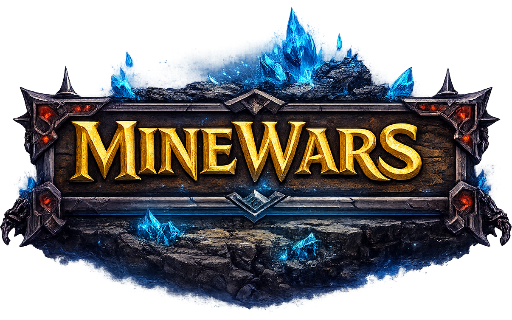
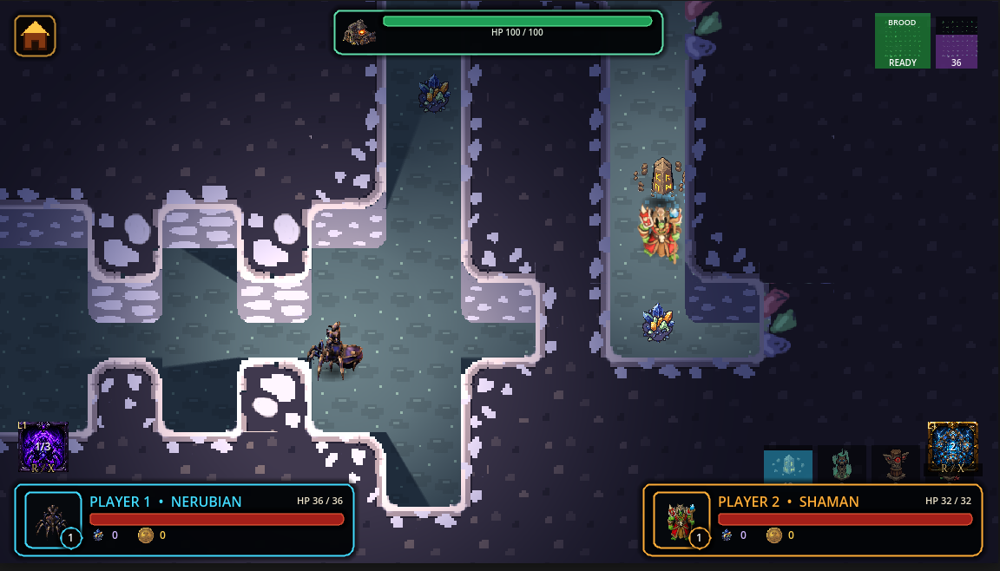
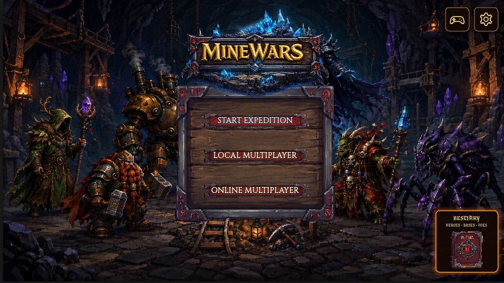
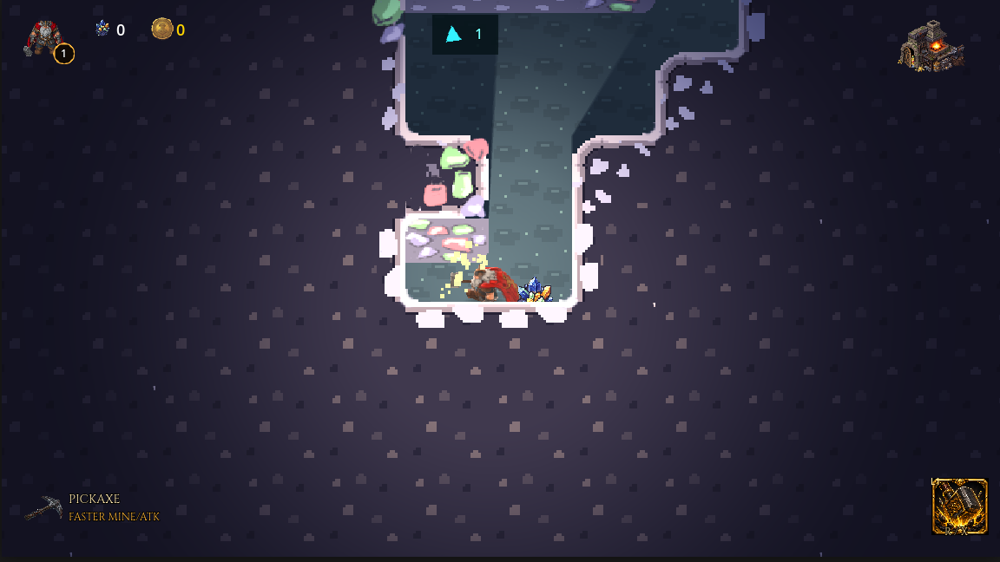
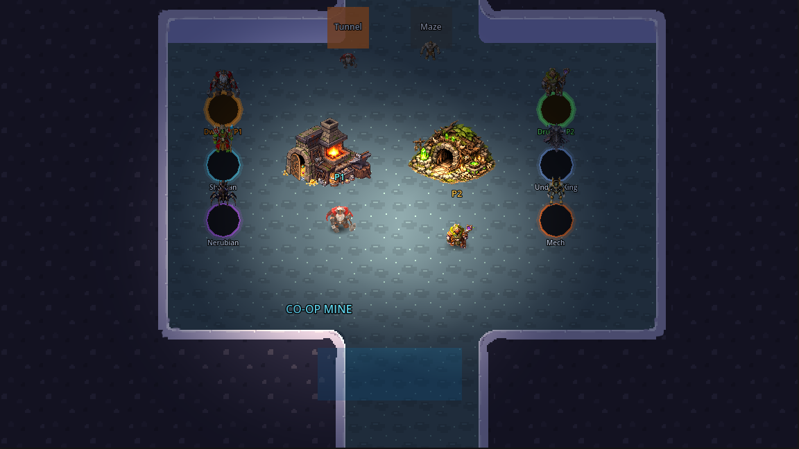
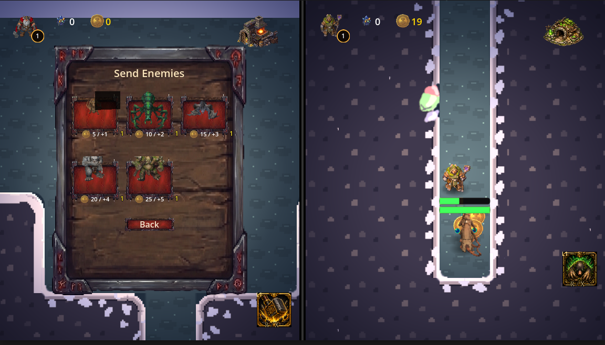
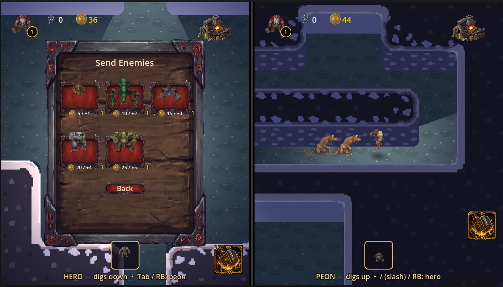

  

  <strong>Delve Deep. Dig Strategically. Dominate the Underground.</strong>
   
  <em>A Warcraft III Hero Line Wars-inspired fantasy mining & defense game built in Godot.</em>

  
  

---

  

## Overview

**MineWars** is a strategic underground battler and mining defense game. Carve out intricate tunnel networks, gather gems and minerals, upgrade your base, and redirect deadly creep waves straight into your rival's territory!

🎮 **Play now in your browser on [itch.io](https://sippos.itch.io/minewars)**

## Key Features

- **Strategic Digging & Tunneling:** Mine custom paths, create choke points, and manipulate wave routing.
- **6 Unique Heroes:** Choose your commander, each with specialized abilities and distinct playstyles:
  - **Dwarf:** Ground stomp, throwing hammers, high-resilience frontline miner.
  - **Shaman:** Totem wheel, chain lightning, aura buffs.
  - **Nerubian:** Web burst, broodmother call, chitinous carapace.
  - **Druid:** Burrow tunnels, mole form, deep roots.
  - **Undead King:** Soul harvest, grave might, raise undead minions.
  - **Mech:** Mechanical worker units and industrial power.
- **6 Distinct Bases & Upgrades:** Fortify your underground citadel and invest in tech trees.
- **Multiple Game Modes:**
  - **Singleplayer Exploration:** Delve into the depths at your own pace in a dedicated solo mode.
  - **Local & Online Co-Op:** Team up to explore, mine, and withstand escalating underground waves.
  - **1v1 Versus Modes:** Send enemies to disrupt your opponent's economy while balancing your income.

## Gameplay Loop

1. **Pick your Hero & Base:** Select your faction from the main menu.
2. **Delve & Mine:** Dig into the mine, harvest ore and gems, and return them safely to your base.
3. **Upgrade:** Purchase pickaxe speed, base defenses, totems, and ability improvements.
4. **Survive or Overrun:** Survive creature waves, or in VS mode, purchase enemy creeps to overrun your opponent and scale your income.

## Screenshots

  
  

  
  

  

## Development Rules

Keep the game playable on `main`. Bigger cleanup work should happen in branches and land in small pull requests:

- One gameplay change at a time.
- One UI refactor at a time.
- No mass file moves without updating Godot `res://` references in the same change.
- Keep itch.io deployment green after every merge.

## Documentation

- [`docs/PROJECT_VISION.md`](docs/PROJECT_VISION.md) — Product direction and target game feel.
- [`docs/ARCHITECTURE.md`](docs/ARCHITECTURE.md) — Current Godot architecture and folder structure.
- [`docs/REFACTOR_PLAN.md`](docs/REFACTOR_PLAN.md) — Cleanup roadmap.
- [`docs/HERO_ABILITY_BALANCE.md`](docs/HERO_ABILITY_BALANCE.md) — Hero abilities & balancing.
- [`docs/LINEWARS_ECONOMY.md`](docs/LINEWARS_ECONOMY.md) — Line wars economy & mechanics.
- [`AGENTS.md`](AGENTS.md) — Rules for AI assistants working in this repo.
